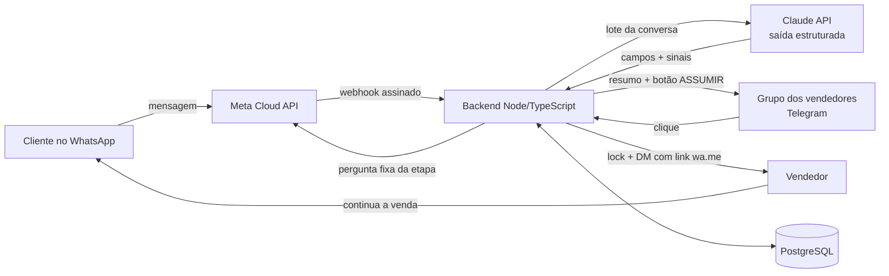

# Atendimento WhatsApp IA

> **English summary.** A production WhatsApp customer-service backend for a building-materials store.
> Incoming messages are triaged by an AI assistant (Claude API, structured output, prompt caching) that
> collects only what a salesperson needs (name, items, quantities, notes). A summary is posted to the
> sales team's Telegram group with an **ASSUME** button; the first salesperson to click gets the lead in a
> private message with a ready-to-send WhatsApp link. Built with Node.js/TypeScript, WhatsApp Cloud API,
> Telegram Bot API and PostgreSQL, running under systemd. Highlights: message batching, a race-free
> "assume" lock, automatic hand-off when the customer stops answering, Telegram group housekeeping,
> LGPD-compliant data retention, logs without personal data, and ~US$ 0.03 of AI cost per conversation.
> 42 test suites run against a real local PostgreSQL with every external API mocked.

> **Código disponibilizado apenas para avaliação de portfólio. Todos os direitos reservados.**
> Os nomes, domínios, telefones e IDs deste repositório são fictícios (ex.: "Loja Exemplo Materiais de
> Construção", `exemplo.com.br`).

## O problema

Uma loja de material de construção recebe pelo WhatsApp muitas mensagens soltas ("tem cimento?",
"quanto custa?", uma foto, um "oi"). Os vendedores perdiam tempo perguntando sempre as mesmas coisas, e
clientes ficavam sem resposta quando ninguém via a mensagem a tempo.

O sistema faz a primeira conversa: cumprimenta, coleta o mínimo (nome, itens, quantidades, observações),
nunca inventa preço, estoque ou prazo, e entrega o atendimento pronto para um vendedor, que continua a
venda pelo WhatsApp dele.

<!-- PRINT: conversa de triagem no WhatsApp (dados fictícios) -->

## Como funciona



1. **Cliente → WhatsApp.** A Meta entrega o webhook (assinatura HMAC conferida, deduplicação por id).
2. **Triagem com IA.** As mensagens seguidas do cliente viram um turno; a Claude devolve JSON com os
   campos e sinais (pergunta comercial, pedido de atendente, acompanhamento de pedido, produto genérico,
   vários itens). A pergunta enviada ao cliente é sempre uma pergunta fixa da etapa, escolhida pelo
   código: a IA classifica, o sistema decide.
3. **Resumo no Telegram.** Com a triagem completa (ou o cliente parado), o resumo vai ao grupo com o
   botão **ASSUMIR**.
4. **Vendedor assume.** O primeiro clique vence; ele recebe no privado os dados e um link `wa.me` com a
   mensagem pronta. O cliente é avisado de quem vai atendê-lo.
5. **Depois disso**, o que o cliente escrever vai direto ao vendedor (ou ao grupo, se ninguém assumiu),
   sem reabrir a triagem.

<!-- PRINT: resumo no grupo do Telegram com o botão ASSUMIR (dados fictícios) -->
<!-- PRINT: mensagem privada ao vendedor com o link wa.me (dados fictícios) -->

## Stack

- **Node.js + TypeScript** (ESM, `strict`, `noUncheckedIndexedAccess`), sem framework web (`node:http`).
- **WhatsApp Cloud API** (Meta): webhook assinado, envio com retry e alerta de falhas seguidas.
- **Claude API** (`@anthropic-ai/sdk`): saída estruturada por JSON Schema, timeout e retry, **prompt
  caching** das instruções e do schema.
- **Telegram Bot API**: grupo dos vendedores, botões inline, mensagens privadas, comandos de administração.
- **PostgreSQL** (`pg`): migrations versionadas, espelho do estado, deduplicação e retenção.
- **systemd + Caddy** em uma VPS Linux: HTTPS automático, desligamento ordenado, alerta de falha do serviço.

## Decisões técnicas interessantes

- **Agrupamento de mensagens.** Cliente costuma mandar 2–3 mensagens seguidas. Cada conversa tem um lote
  que fecha 4 s depois da última mensagem (no máximo 12 s); se chegar mensagem nova enquanto a IA
  responde, a resposta é descartada e o próximo lote responde com todo o contexto. A ordem é garantida por
  uma fila por conversa, sem nenhum `await` entre a leitura do lote da Meta e o enfileiramento.
- **Lock do "ASSUMIR".** Dois vendedores clicando ao mesmo tempo: lock síncrono em memória e, como segundo
  portão, `UPDATE` condicional no banco (se o banco já tem outro vendedor, ele vence — protege depois de
  um reinício). Quem pode assumir é decidido pelo `getChatMember` do grupo a cada clique.
- **Nenhum cliente se perde.** Triagem parada vai sozinha ao vendedor: 3 min sem resposta às observações,
  3 min depois de uma mídia sem continuação, 10 min parada com nome ou produto. Atendimento encaminhado
  fica ativo até o fim do dia seguinte; mensagens novas são repassadas ao vendedor em vez de abrir uma
  nova triagem. Lembrete no grupo para resumo sem ninguém assumir.
- **Faxina do grupo.** O bot apaga o que já não serve (lembrete ao assumir, resumo 30 min depois da
  assunção, respeitando o limite de 48 h do Telegram) e leva ao privado de quem assumiu as mensagens que o
  cliente mandou antes. Os `message_id` ficam no banco para funcionar depois de um reinício.
- **IA que classifica, código que decide.** A Claude não escreve o que o cliente lê: devolve sinais
  (ex.: `pergunta_comercial`, `pedido_atendente`, `acompanhamento`, classificação da resposta na etapa do
  nome), e o código valida cada valor (fora do esperado → regra de reserva por texto). Isso eliminou
  respostas inventadas e deixou o comportamento testável.
- **Custo por conversa.** As instruções e o schema (~5,8 mil tokens) vão num bloco com `cache_control`
  e são lidos do cache a 0,1× do preço; só a conversa fica fora. Mensagens que não precisam da IA (mídia,
  "ok", mensagens depois do encaminhamento) não chamam a Claude. Resultado: cerca de **US$ 0,03 por
  atendimento completo**.
- **Reinício sem perder nada.** A memória é a fonte de verdade e o banco é um espelho; na partida, a
  recuperação reconstrói conversas, resumos e locks, e reprocessa mensagens que chegaram e não foram
  processadas. SIGTERM: novas requisições recebem 503 (a Meta e o Telegram reenviam) e a fila termina
  antes de sair.
- **LGPD e logs.** Logs dizem o que o sistema fez, nunca o que o cliente disse: telefone mascarado,
  `wamid` só como hash, erro de biblioteca sem a mensagem original (garantido por testes com canários).
  Retenção automática: texto das conversas apagado em 60 dias, atendimento anonimizado em 365 dias,
  script para o pedido de exclusão do titular.

<!-- PRINT: comando /ranking ou /ajuda no privado do bot (dados fictícios) -->

## Estrutura

```
src/        backend (webhook da Meta e do Telegram, triagem, persistência, retenção)
sql/        migrations (001–009) e o papel do banco sem DDL
tests/      42 suítes (servidor real + PostgreSQL de teste; Meta, Telegram e Claude simulados)
scripts/    migrate, acompanhamento só leitura e pedido de exclusão (LGPD)
deploy/     systemd, Caddy, journald, atualização e backup (exemplo)
```

## Como rodar localmente

Requisitos: Node.js 22+ e PostgreSQL 15+.

```bash
npm ci
cp .env.example .env          # preencha banco, Meta, Claude e Telegram
createdb atendimento          # ou crie pelo seu cliente do PostgreSQL
npm run migrate               # aplica sql/001..009 (como dono do banco)
npx tsx src/mainwebhook.ts    # desenvolvimento
# produção: npm run build && node dist/mainwebhook.js
```

Rotas: `GET/POST /meta/webhook`, `POST /telegram/webhook`, `GET /health`. Com `META_ENVIO_ATIVO=false`
nada é enviado ao WhatsApp (só log), útil para testar o fluxo.

## Testes

```bash
npm test
```

- Recria do zero o schema do banco **`atendimento_teste`** (nunca o banco principal; trava dupla por nome
  e por `current_database()`) e roda as 42 suítes em sequência.
- Usa só `DB_HOST`, `DB_PORT`, `DB_USER` e `DB_PASSWORD` do `.env`; as credenciais da Meta, do Telegram e
  da Anthropic são falsas e toda chamada de rede externa é bloqueada.
- Cobre: ordem do lote da Meta, deduplicação, agrupamento, triagem, perguntas comerciais, lock do
  ASSUMIR, recuperação e reinício (processo filho), desligamento ordenado, retenção, faxina do grupo e
  logs sem dados pessoais.

<!-- PRINT: saída do npm test (todas as suítes passando) -->

---

Código disponibilizado apenas para avaliação de portfólio. Todos os direitos reservados.
